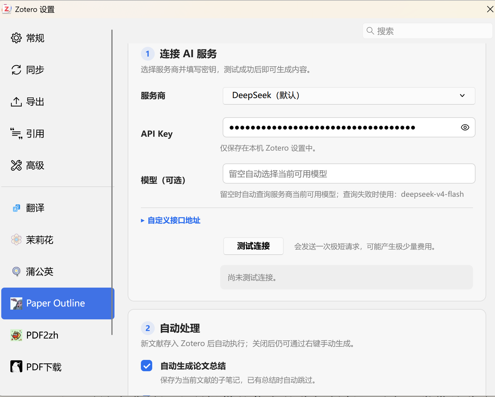

<p align="center">
  
</p>

<h1 align="center">Paper Outline</h1>

<p align="center">
  <strong>让 Zotero 自动读论文：生成整篇总结与可跳转的层级目录。</strong>
</p>

<p align="center">
  新文献入库后自动处理，也支持右键手动生成；扫描论文可先经 MinerU 识别并持久化缓存，再继续生成总结和目录。
</p>

<p align="center">
  <a href="https://github.com/DrinkTea905/zotero-paper-outline/releases/latest"></a>
  
  <a href="https://github.com/DrinkTea905/zotero-paper-outline/releases"></a>
  <a href="LICENSE"></a>
  
</p>

<p align="center">
  <a href="https://github.com/DrinkTea905/zotero-paper-outline/releases/latest"><strong>下载安装</strong></a>
  ·
  <a href="#v180-新增亮点">v1.8.0 亮点</a>
  ·
  <a href="#功能介绍">功能介绍</a>
  ·
  <a href="#第一次使用">第一次使用</a>
  ·
  <a href="https://github.com/DrinkTea905/zotero-paper-outline/issues">问题反馈</a>
</p>

---

## Paper Outline 是什么？

Paper Outline 是一个专注、轻量的 Zotero 论文阅读插件。它不提供聊天窗口，而是直接完成阅读前最耗时间的几件事：

- 通读论文并生成结构化的中文整篇总结，支持按学科切换总结模板；
- 提取或生成带页码的层级目录与逐节摘要，显示在阅读器左侧大纲栏；
- 点击目录直接跳到正文对应位置，翻页时自动高亮当前章节，并支持展开摘要与复制 Markdown；
- 遇到只有页面图片的扫描 PDF，可使用 MinerU 识别文字并持久化缓存，避免重复上传识别；
- 新文献进入 Zotero 后自动处理，也可以按需手动生成；
- 阅读器中的插件界面意外消失时，可从菜单一键重新唤起，无需重启 Zotero；
- 阅读器工具栏提供「复制信息」和「复制 PDF」双快捷按钮，一键复制“题名 - 作者 - 年份”或当前 PDF 文件；
- 把连接测试、一键拉取与自动追新模型、PDF 文件复制和中文空格清理等高频操作集中到一个插件里。

兼容 **Zotero 7 / 8 / 9 / 10**，免费开源。

## v1.8.0 新增亮点

- **模型自动追新防失效 + 设置页一键「拉取模型」**：模型栏留空时自动识别服务商最新可用模型，遇到模型下线或更名时自动刷新追新；设置页新增一键「拉取模型」，直接获取并选择当前可用模型，告别手动查文档和抄写模型 ID。
- **长上下文免切块与参考文献裁剪**：面向长上下文模型优先整篇直读、减少不必要的分段切块，并自动裁剪文末参考文献等低信息密度内容，把上下文预算留给核心正文，提升总结完整度与目录准确度。
- **多学科总结模板**：内置多学科论文总结模板，可按研究领域一键切换关注维度，也支持自定义提示词与一键恢复默认。
- **阅读器大纲摘要展开与 Markdown 复制**：左侧大纲栏支持展开/收起逐节摘要，并支持一键复制完整层级目录与摘要为 Markdown，方便直接整理到外部笔记或写作草稿。
- **扫描 PDF 识别缓存持久化与自动处理优化**：MinerU 识别结果持久化缓存到本地，重做目录或总结时无需重复上传与重复消耗额度；同时优化入库自动处理队列调度与异常恢复体验。

## 功能介绍

### 1. 可跳转的论文层级目录与摘要

打开 PDF 后，Paper Outline 会把论文目录显示在 Zotero 阅读器左侧的大纲栏中：

- 保留一级、二级、三级等真实章节关系；
- 每个章节附带简短中文摘要，支持在阅读器大纲栏中展开与收起查看；
- 支持一键将当前目录与摘要复制为 Markdown 文本；
- 点击章节直接跳到正文对应页；
- 阅读时自动高亮当前章节；
- 支持展开、收起和一键重新生成；
- 侧栏收起后再次展开，目录会自动恢复。

插件会优先读取 PDF 自带书签。没有书签时，才从全文生成目录，避免不必要的接口调用。

针对论文前部自带“目录 / 目次”页的情况，定位时会优先寻找正文标题，避免所有章节都跳到第一页；已有的错误页码缓存也会在打开文献时自动修复。

### 2. 整篇论文总结与多学科模板

Paper Outline 会通读全文，生成便于回顾和引用的结构化中文总结，并保存为当前文献的 Zotero 子笔记。

针对长篇论文，插件会结合当前模型上下文能力优先整篇免切块阅读，并在超长时优先裁剪文末参考文献，尽量保留正文论证与数据细节。

默认总结包括：

- 论文核心研究问题；
- 研究对象与主要观点；
- 研究背景、制度沿革或理论脉络；
- 关键数据、案例和规则；
- 主要论证过程与结论；
- 分级标题、重点加粗和清晰段落。

支持在设置页切换**多学科总结模板**，满足不同学科对研究方法、实证结果、规范分析或理论贡献的侧重需求。已有总结时会自动跳过，避免重复生成；目录提示词和总结提示词都可以自行修改，也可以分别点击“恢复默认”。

### 3. 扫描 PDF 识别与持久化缓存

扫描版论文通常只有页面图片，插件看不到可供总结和生成目录的文字。设置 MinerU 后，Paper Outline 会在本地无法读取文字时，把当前扫描 PDF 交给 MinerU 识别，再继续原来的总结和目录流程。

- 普通、已有文字层的 PDF 不会上传；
- **识别结果本地持久化缓存**：同一份扫描 PDF 识别完成后会缓存识别文本，后续重新生成目录或补充总结时直接复用，避免重复上传；
- 可以选择“扫描件默认上传”，也可以保持关闭、每次上传前确认；
- MinerU Token 只保存在本机 Zotero 设置中；
- Token 有效期为 90 天，插件会按保存时间估算到期日，并在临近到期或可能过期时提醒；
- 设置页可直接检查连接，也可跳转到 MinerU 创建新 Token。

### 4. 新文献入库后自动处理

默认开启自动处理。把带 PDF 的文献保存进 Zotero 后，插件会自动生成：

- 一份整篇总结，保存为子笔记；
- 一份层级目录，显示在阅读器大纲栏。

批量导入时会自动排队并控制并发；已生成过的内容会跳过，并对异常状态和重试链路做了进一步稳定性优化。关闭自动处理后，仍可通过文库右键菜单手动生成。

### 5. 生成前测试 AI 连接

设置页和阅读器未生成目录的空白栏中，都可以直接点击“测试连接”。

连接成功时会显示：

- 当前实际使用的服务商；
- 实际模型名称；
- 本次请求的响应时间。

连接失败时会尽量转换成容易理解的中文提示，帮助判断 API Key、余额、模型名称或接口地址是否存在问题。

测试会发送一次极短请求，可能产生极少量接口费用。

### 6. 模型自动追新与一键拉取模型

模型栏可以留空，也可以在设置页点击**「拉取模型」**从当前服务商实时获取模型列表并直接点选：

- **自动追新防失效**：留空时插件会自动查询服务商当前可用模型并优先选择合适的新版本，不必长期追着服务商的模型改名或下线修改设置；
- 正式生成遇到模型变更或失效时，会自动刷新模型列表并重试一次；
- 手动填写或点选固定模型名称时，始终尊重用户指定的模型；
- 查询失败时自动回退至内置兜底模型；
- 自定义中转接口同样支持填写接口地址后拉取或指定模型。

### 7. 支持国内主力与本地 AI 服务

| 服务商 | 说明 |
| --- | --- |
| DeepSeek | 默认选项，模型栏可留空自动追新 |
| Xiaomi MiMo | 官方接口，超大上下文，适合长篇论文免切块通读 |
| Kimi | 月之暗面（Moonshot）官方接口，擅长长文本理解 |
| 智谱 GLM | 智谱官方接口，支持主流 GLM 系列模型 |
| 通义千问 | 阿里云百炼 / DashScope 官方兼容接口 |
| 硅基流动 | SiliconFlow 接口，聚合多款主流国产与开源模型 |
| 本地 Ollama | 本地运行，无需 API Key，数据不出本机 |
| 自定义 | 支持任意 OpenAI 兼容接口地址与自定义模型 |

API URL、API Key 和模型名称会按服务商分别保存在本机；切换服务商时自动恢复各自上次使用的配置。

### 8. 一次复制多篇 PDF 文件

在 Zotero 文库中单选或多选文献后，可以把本地 PDF **文件本身**复制到剪贴板，再直接粘贴到文件夹、邮件或聊天窗口。

- Windows 支持一次复制并粘贴多份 PDF；
- 支持文库中的 `Ctrl+C` 和右键“复制 PDF 文件”；
- 写入剪贴板后会自动核对文件数量；
- 没有本地 PDF 附件的条目会明确提示；
- 正常复制阅读器文字时，不会被误判成复制 PDF 文件。

这项功能复制的是附件文件，不是题录，也不是 PDF 中的文字。

### 9. 清理中文 PDF 复制空格

部分中文 PDF 复制出来后，字与字之间会夹着大量空格。Paper Outline 提供两种本地清理方式：

- **清理复制文字**：复制中文 PDF 文字后，点击阅读器工具栏中的粉色小猫图标，再粘贴即可得到连续文本；
- **清理全部标注**：在阅读器“注释”栏中，一次清理当前 PDF 所有标注文字和批注中的多余空格。

处理过程只使用本地规则，不调用 AI、不联网、不产生接口费用；英文单词之间的正常空格会保留。

### 10. 一键复制当前文献信息与 PDF

打开 PDF 后，阅读器工具栏会在粉色小猫旁显示两个紧凑的单击按钮：

- **复制信息**：复制完整的“题名 - 作者 - 年份”；
- **复制 PDF**：把当前 PDF 文件放入剪贴板，可直接粘贴到文件夹、邮件或聊天窗口。

例如：`犯罪统计与犯罪治理的优化 - 卢建平 - 2021`

这项功能直接读取当前 PDF 对应的 Zotero 条目，不调用 AI、不联网，也不会修改文献元数据。

### 11. 更清楚的设置界面

设置页按照实际使用顺序整理为 AI 连接、扫描 PDF 识别、自动处理、生成偏好、实用工具、高级设置和帮助等区域：

- 重要设置优先展示，提供「拉取模型」与「测试连接」快捷操作；
- 支持直接选择多学科总结模板，并可按需展开编辑自定义提示词；
- 文字层级、间距、按钮和勾选框样式统一；
- API URL、API Key 和模型名称按服务商分别保存在本机 Zotero 设置中；
- 深度思考是插件级通用开关，默认关闭，只对已声明支持的内置服务商生效；
- 内置第一次使用、手动生成和故障排查说明。

<p align="center">
  
</p>

## 安装

1. **[下载最新版本 `paper-outline-gpt.xpi`](https://github.com/DrinkTea905/zotero-paper-outline/releases/latest)**。
2. 打开 Zotero，进入 **工具 → 插件**。
3. 点击右上角齿轮，选择 **Install Add-on From File…**。
4. 选择刚下载的 `.xpi` 文件，并按提示重启 Zotero。

插件已经配置自动更新。后续发布新版本时，Zotero 会自动检查并升级。

## 第一次使用

1. 打开 **Zotero 设置 → Paper Outline**。
2. 选择 AI 服务商（默认 DeepSeek）。
3. 填写 API Key；使用本地 Ollama 时无需 Key。
4. 模型栏建议留空让插件自动追新，或点击 **拉取模型** 直接选择。
5. 点击 **测试连接**。
6. 看到绿色“连接成功”后，即可开始生成。

如果希望新文献自动生成总结和目录，保持“自动处理”中的两个开关开启即可。

如果文献中有扫描 PDF，可在同一设置页粘贴 MinerU Token，并点击“检查连接”。是否默认上传扫描件可按自己的隐私习惯选择；关闭时，每次上传前都会询问。

## 日常使用

### 自动生成

把带 PDF 的文献保存进 Zotero。插件会在后台排队生成总结和目录，完成后给出提示。

### 手动生成

- **文库中**：选中一篇或多篇文献，右键选择“AI 整篇总结”或“AI 生成目录”；
- **阅读器中**：打开 PDF，在左侧大纲栏点击“生成目录”；
- **需要重做时**：在大纲栏点击“重新生成”。

### 查看与导出结果

- 整篇总结保存在文献的子笔记中；
- 层级目录与逐节摘要显示在阅读器左侧大纲栏，支持展开/收起摘要与一键复制 Markdown；
- 点击目录条目即可跳到相应正文页；
- 工具栏中的「复制信息」按钮可直接复制“题名 - 作者 - 年份”，「复制 PDF」按钮可直接复制当前 PDF 文件。

### 阅读器里的插件界面突然消失

在 Zotero 主窗口点击 **工具 → 重新唤起 Paper Outline**。如果 PDF 在独立阅读器窗口中打开，也可以点击 **查看 → 重新唤起 Paper Outline**。插件会重新挂载当前 PDF 的目录栏和工具按钮，不会重新调用 AI，也不会清除已有目录。

## 常见问题

### 点击生成后没有结果

- 先点击“测试连接”，根据提示检查 Key、余额、模型名称和接口地址；
- 普通 PDF 会直接读取文字；扫描版 PDF 请在设置中填写 MinerU Token；
- 如果提示 Token 到期，请前往 MinerU 重新创建并替换；
- 少数缺少 Unicode 映射的 PDF 会使用 Zotero 全文索引估算页码，可能存在约 ±1 页误差。

### 提示“无法连接 MinerU 结果服务器”

多数用户无需进行额外设置。只有出现这条提示时，才需要检查当前网络：

- 如果正在使用代理、VPN 或网络加速工具，可先暂时关闭后重试；
- 关闭后恢复正常，通常说明 MinerU 识别结果的下载地址被代理影响；
- 请在所用工具的“直连”“绕过代理”或“排除列表”中加入 `cdn-mineru.openxlab.org.cn`；
- 使用 Clash 时，可添加 `DOMAIN,cdn-mineru.openxlab.org.cn,DIRECT`，并使用“规则”模式；其他工具请使用含义相同的直连设置；
- 没有使用代理仍然失败时，可稍后重试、切换网络，或检查安全软件是否限制 Zotero 联网。

### 为什么模型栏建议留空？

服务商可能调整模型名称或下线旧模型。留空时，插件会优先查询当前可用模型并自动追新；如果想固定某个模型，也可以点击设置页的「拉取模型」直接选定或手动填写。

### 为什么已有目录或总结时没有重新生成？

插件默认跳过已有结果，避免重复调用和重复笔记。需要更新时可以点击“重新生成”。

### 数据保存在哪里？

- API Key 保存在本机 Zotero 设置中；
- MinerU Token 及其保存时间保存在本机 Zotero 设置中；
- 整篇总结保存在 Zotero 子笔记中；
- 目录与扫描识别缓存保存在 Zotero 数据目录的本地缓存文件中；
- 去空格和 PDF 文件复制功能只在本机处理。

只有在 PDF 没有可读取文字、且本地无有效识别缓存，并得到用户允许或已开启“扫描件默认上传”时，当前 PDF 才会发送至 MinerU 完成文字识别。

## 开发与打包

<details>
<summary>查看开发说明</summary>

```powershell
# Python（默认自动校验 manifest/update、构建并同步 update_hash；加 --run-tests 可先跑单测）
python -B build_xpi.py --run-tests

# PowerShell 一键打包（委托调用 python -B build_xpi.py --run-tests）
powershell -ExecutionPolicy Bypass -File .\打包.ps1
```

生成文件为 `paper-outline-gpt.xpi`（使用临时文件校验完整性后原子替换，并自动将 SHA-256 写入 `update.json` 的 `update_hash`；如需跳过哈希同步可传 `--no-sync-hash`）。

主要文件：

```text
paper-outline-plugin/
├─ manifest.json       插件清单
├─ update.json         自动更新清单（含 update_hash）
├─ bootstrap.js        生命周期、窗口与阅读器钩子
├─ paperOutline.js     全文、目录、AI、跳页与缓存逻辑
├─ preferences.xhtml   设置页面
├─ preferences.js      设置交互与连接测试
├─ preferences.css     设置页面样式
├─ prefs.js            默认设置
├─ icons/icon.png      插件图标
├─ build_xpi.py        XPI 校验、测试与原子打包脚本
└─ 打包.ps1            Windows PowerShell 打包入口
```

</details>

## 反馈与交流

- 发现问题或希望增加功能：[提交 Issue](https://github.com/DrinkTea905/zotero-paper-outline/issues)
- 分享使用方式或讨论想法：[GitHub Discussions](https://github.com/DrinkTea905/zotero-paper-outline/discussions)

## 许可

[MIT](LICENSE) © 独钓寒江雪。AI 协作开发。
